# Entity-Relationship Diagram

<!-- GENERATED FILE. Run `make erd` to regenerate. Prose lives in cmd/erdgen. -->

Read from the live catalog at migration `0011_index_foreign_keys`. Tables, columns, foreign keys,
delete behaviour and index counts come from `information_schema` and
`pg_constraint` — never from memory, so this file cannot quietly drift from the
database it describes.

**38 tables · 62 foreign keys · 142 indexes (67 unique, 47 partial) · 10 modules**

---

## How to read this

Every table has exactly one **owning module**. Nothing outside a module writes to
its tables; cross-module reads go through an interface in `internal/contracts`.
`make check-boundaries` fails the build if that is violated, which is what makes
the boundary a compile-time fact rather than a convention.

Diagrams are split per module. One diagram of 38 tables and 62 edges is a picture
of a schema, not a map of one — so the edges that leave a module are listed
instead, under [Cross-module seams](#cross-module-seams). Those are the cut lines
a service extraction would follow.

Each module diagram shows primary keys, foreign keys and the first few business
columns. The [complete column reference](#complete-column-reference) has all 491.

### Conventions

| Convention | Reason |
|---|---|
| `uuid` primary keys, UUIDv7 generated in Go | Time-ordered, so inserts append to the right edge of the index instead of scattering across it |
| Money as `bigint` in paise | Floats drift: `0.1 + 0.2 != 0.3`. A ledger off by a paise per order is unreconcilable |
| Quantities as `numeric(14,3)` | Ingredient amounts are genuinely fractional, with no natural smallest unit across flour, milk and eggs |
| `timestamptz` everywhere | `timestamp` silently reinterprets under a server timezone change, corrupting every order history |
| `CHECK` constraints, not `ENUM` | A value cannot be removed from a Postgres enum; a check is a one-line migration |
| 47 of 142 indexes are partial | History costs nothing to skip when the index only covers the hot subset |
| Soft delete on `users` | Orders reference them and financial records must survive account closure |

---

## Module dependencies

Solid arrows are synchronous calls through a `contracts` interface. Dashed arrows
are events — the seams that survive a service split, because the publisher does
not know who listens.

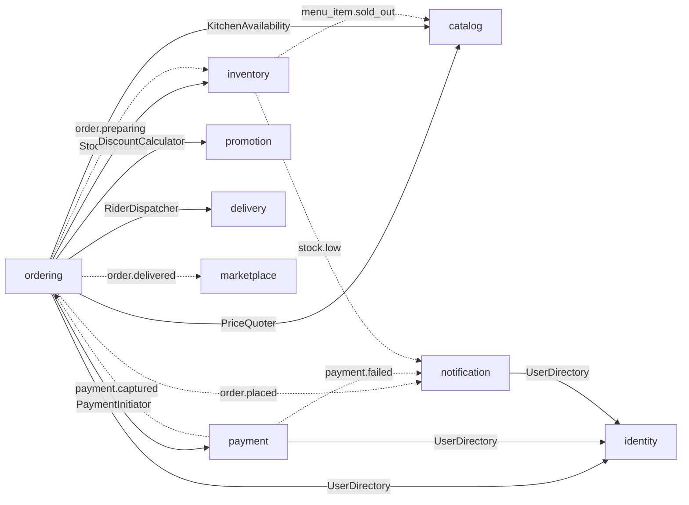

Note the shape: **ordering depends on six modules, and nothing depends on
ordering except through events.** That asymmetry is deliberate — the spine
orchestrates, and everything downstream reacts.

---

## Order lifecycle

The state machine is declared as data in `ordering/domain/order.go`, so an
illegal transition is impossible by construction rather than prevented by
scattered `if` statements. `orders.status` carries a `CHECK` constraint listing
the same states.

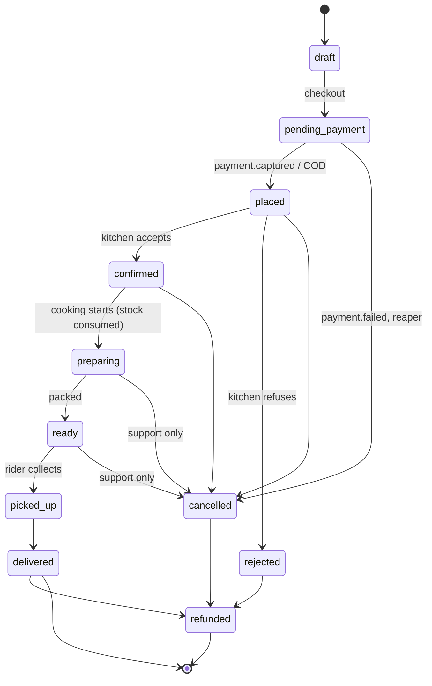

Two transitions that are absent on purpose:

- **`picked_up` cannot be cancelled.** The food is with the rider; a failed
  delivery is resolved as a refund on the delivered order, not by rewinding.
- **`pending_payment` cannot reach `confirmed`.** Money must land before the
  kitchen sees the order, or a failed UPI payment means food cooked for free.

---

## `identity`

Accounts, sessions, saved addresses. Phone is the primary credential; email is optional.

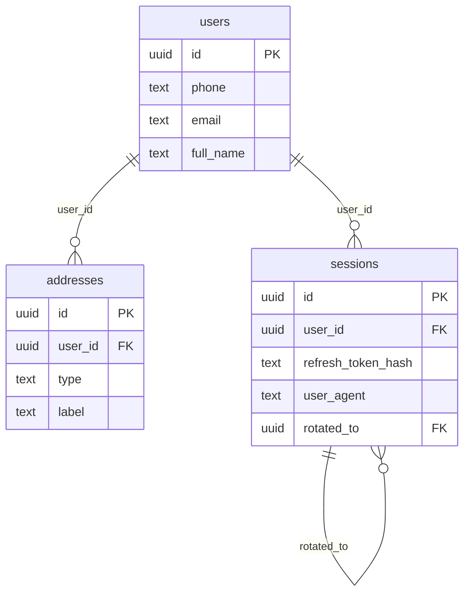

| Table | Cols | Indexes | Grows with |
|---|---|---|---|
| `addresses` | 17 | 3 (2 unique, 1 partial) | signups |
| `sessions` | 11 | 5 (2 unique, 2 partial) | logins |
| `users` | 15 | 8 (4 unique, 3 partial) | signups |

## `catalog`

Kitchens (outlets), opening hours, the menu tree — and the authoritative price of everything.

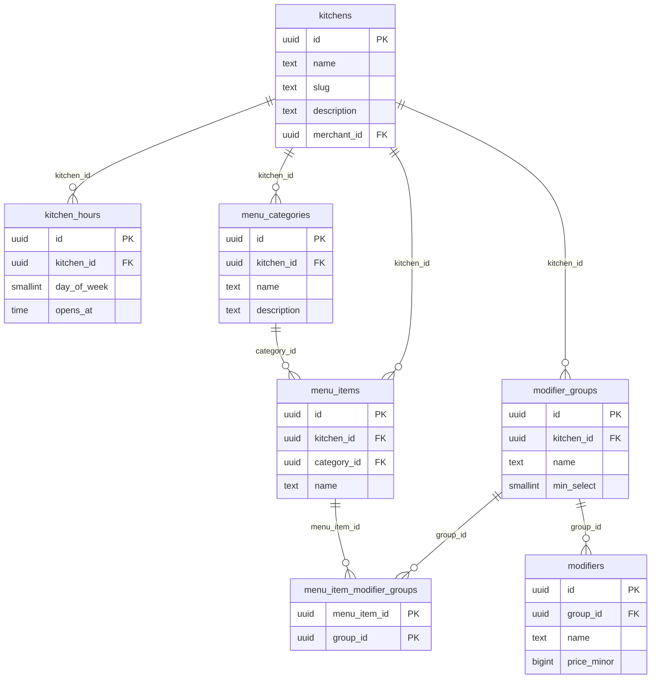

| Table | Cols | Indexes | Grows with |
|---|---|---|---|
| `kitchen_hours` | 5 | 2 (1 unique) | outlets |
| `kitchens` | 29 | 5 (2 unique, 2 partial) | outlets |
| `menu_categories` | 8 | 2 (1 unique, 1 partial) | menu size |
| `menu_item_modifier_groups` | 2 | 1 (1 unique) | menu size |
| `menu_items` | 26 | 5 (1 unique, 1 partial) | menu size |
| `modifier_groups` | 7 | 2 (1 unique) | menu size |
| `modifiers` | 6 | 2 (1 unique) | menu size |

## `ordering`

The spine. The only module permitted to create an order, and the publisher of the `order.*` events every other module reacts to.

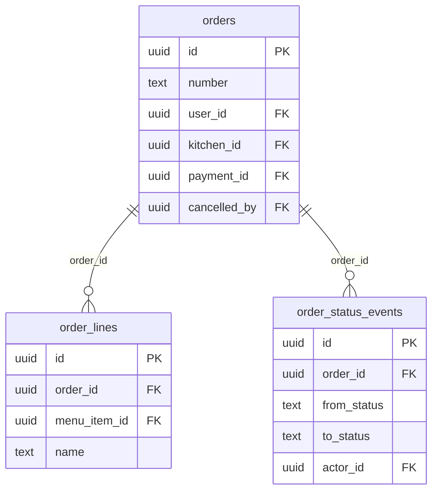

| Table | Cols | Indexes | Grows with |
|---|---|---|---|
| `order_lines` | 11 | 3 (1 unique) | **every order** |
| `order_status_events` | 8 | 3 (1 unique, 1 partial) | **every transition** |
| `orders` | 41 | 7 (2 unique, 3 partial) | **every order** |

## `payment`

Gateway integration. The gateway is the only authority on whether money moved.

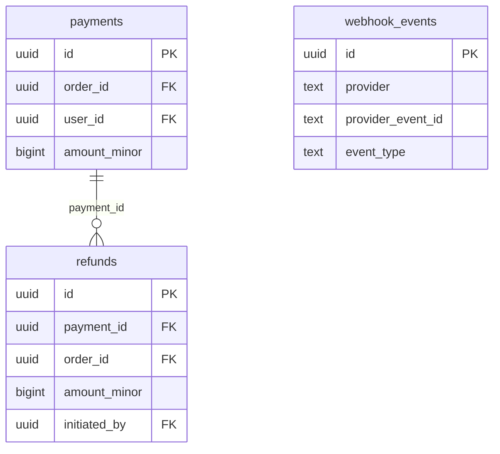

| Table | Cols | Indexes | Grows with |
|---|---|---|---|
| `payments` | 19 | 6 (3 unique, 3 partial) | **every prepaid order** |
| `refunds` | 11 | 3 (1 unique) | disputes |
| `webhook_events` | 9 | 3 (2 unique, 1 partial) | **every gateway event** |

## `inventory`

Stock as an append-only ledger plus a cached balance. Solves the overselling problem.

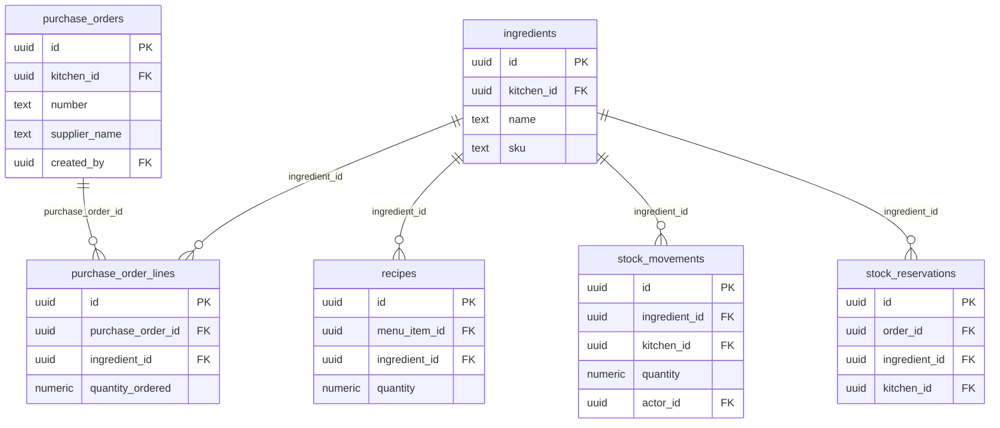

| Table | Cols | Indexes | Grows with |
|---|---|---|---|
| `ingredients` | 16 | 4 (2 unique, 3 partial) | pantry size |
| `purchase_order_lines` | 6 | 3 (1 unique) | procurement |
| `purchase_orders` | 14 | 3 (2 unique) | procurement |
| `recipes` | 7 | 3 (2 unique) | menu size |
| `stock_movements` | 12 | 4 (1 unique, 1 partial) | **every cook** |
| `stock_reservations` | 10 | 5 (2 unique, 2 partial) | **every order** |

## `delivery`

Deliberately thin: a per-drop adapter over a logistics provider, or the kitchen's own rider.

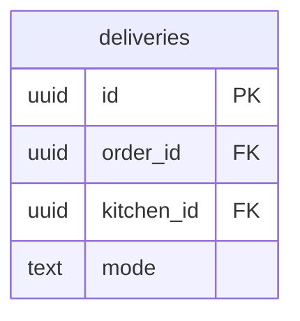

| Table | Cols | Indexes | Grows with |
|---|---|---|---|
| `deliveries` | 19 | 5 (3 unique, 3 partial) | **every order** |

## `promotion`

Coupons and redemptions. Preview never consumes a use.

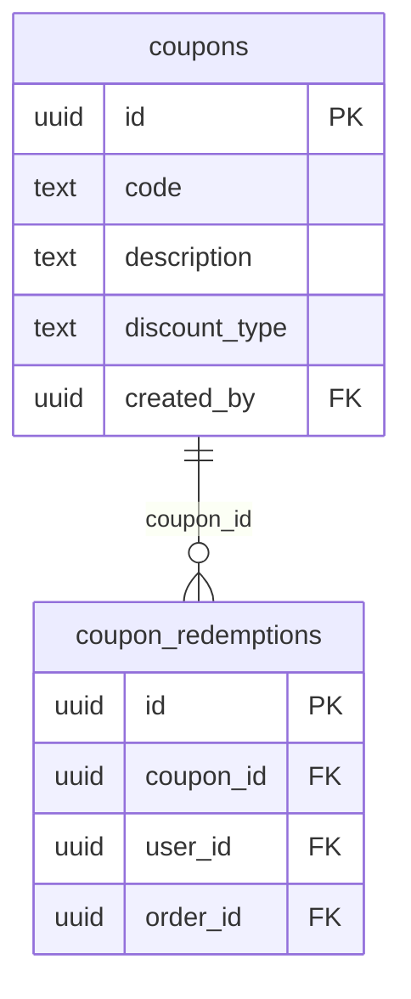

| Table | Cols | Indexes | Grows with |
|---|---|---|---|
| `coupon_redemptions` | 7 | 4 (2 unique, 2 partial) | coupon usage |
| `coupons` | 19 | 3 (2 unique, 1 partial) | campaigns |

## `notification`

Subscribes to nine events; nothing subscribes to it.

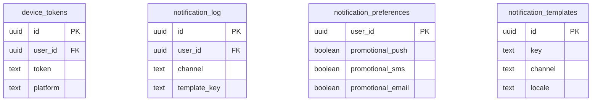

| Table | Cols | Indexes | Grows with |
|---|---|---|---|
| `device_tokens` | 10 | 3 (2 unique, 1 partial) | installs |
| `notification_log` | 14 | 4 (2 unique, 1 partial) | **every message** |
| `notification_preferences` | 7 | 1 (1 unique) | opt-outs |
| `notification_templates` | 11 | 2 (2 unique) | copy changes |

## `marketplace`

Dormant today: one first-party merchant at 0% commission. Money movement is an immutable ledger.

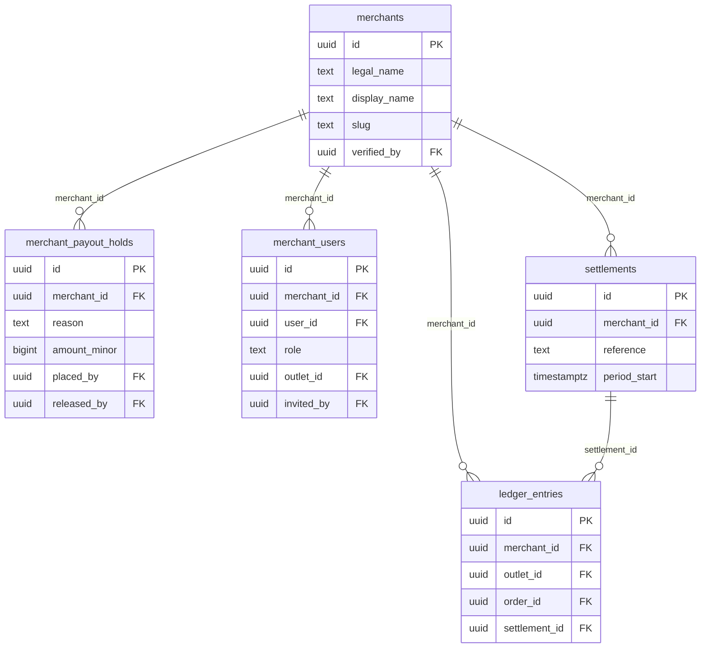

| Table | Cols | Indexes | Grows with |
|---|---|---|---|
| `ledger_entries` | 12 | 7 (2 unique, 5 partial) | **every delivered order** |
| `merchant_payout_holds` | 8 | 2 (1 unique, 1 partial) | investigations |
| `merchant_users` | 8 | 5 (3 unique, 2 partial) | partner staff |
| `merchants` | 30 | 6 (4 unique, 3 partial) | partners |
| `settlements` | 21 | 5 (3 unique, 2 partial) | payout cycles |

## `platform`

Infrastructure owned by no business module.

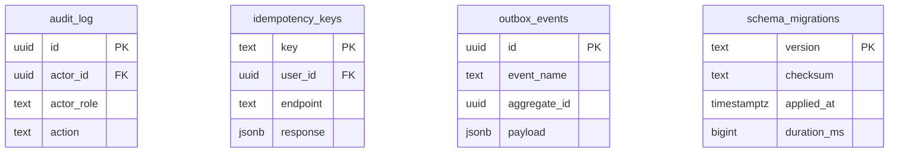

| Table | Cols | Indexes | Grows with |
|---|---|---|---|
| `audit_log` | 12 | 4 (1 unique) | admin actions |
| `idempotency_keys` | 8 | 4 (1 unique) | **every write** |
| `outbox_events` | 11 | 4 (1 unique, 2 partial) | **every state change** |
| `schema_migrations` | 4 | 1 (1 unique) | migrations |

---

## Cross-module seams

Of 62 foreign keys, **26 are structural seams** — a real data dependency crossing
a module boundary. Extracting a module means replacing each with an API call, and
the delete behaviour is the guarantee that extraction must preserve.

| Child | → Parent | Column | On delete | Cardinality | Crosses |
|---|---|---|---|---|---|
| `kitchens` | `merchants` | `merchant_id` | `RESTRICT` | many-to-one | catalog → marketplace |
| `deliveries` | `kitchens` | `kitchen_id` | `RESTRICT` | many-to-one | delivery → catalog |
| `deliveries` | `orders` | `order_id` | `CASCADE` | **one-to-one** | delivery → ordering |
| `ingredients` | `kitchens` | `kitchen_id` | `CASCADE` | many-to-one | inventory → catalog |
| `purchase_orders` | `kitchens` | `kitchen_id` | `CASCADE` | many-to-one | inventory → catalog |
| `recipes` | `menu_items` | `menu_item_id` | `CASCADE` | many-to-one | inventory → catalog |
| `stock_movements` | `kitchens` | `kitchen_id` | `CASCADE` | many-to-one | inventory → catalog |
| `stock_reservations` | `kitchens` | `kitchen_id` | `CASCADE` | many-to-one | inventory → catalog |
| `stock_reservations` | `orders` | `order_id` | `CASCADE` | many-to-one | inventory → ordering |
| `ledger_entries` | `orders` | `order_id` | `RESTRICT` | many-to-one | marketplace → ordering |
| `ledger_entries` | `kitchens` | `outlet_id` | `SET NULL` | many-to-one | marketplace → catalog |
| `merchant_users` | `kitchens` | `outlet_id` | `CASCADE` | many-to-one | marketplace → catalog |
| `merchant_users` | `users` | `user_id` | `CASCADE` | many-to-one | marketplace → identity |
| `device_tokens` | `users` | `user_id` | `CASCADE` | many-to-one | notification → identity |
| `notification_log` | `users` | `user_id` | `SET NULL` | many-to-one | notification → identity |
| `notification_preferences` | `users` | `user_id` | `CASCADE` | **one-to-one** | notification → identity |
| `order_lines` | `menu_items` | `menu_item_id` | `RESTRICT` | many-to-one | ordering → catalog |
| `orders` | `kitchens` | `kitchen_id` | `RESTRICT` | many-to-one | ordering → catalog |
| `orders` | `payments` | `payment_id` | `SET NULL` | many-to-one | ordering → payment |
| `orders` | `users` | `user_id` | `RESTRICT` | many-to-one | ordering → identity |
| `payments` | `orders` | `order_id` | `RESTRICT` | many-to-one | payment → ordering |
| `payments` | `users` | `user_id` | `RESTRICT` | many-to-one | payment → identity |
| `refunds` | `orders` | `order_id` | `RESTRICT` | many-to-one | payment → ordering |
| `idempotency_keys` | `users` | `user_id` | `CASCADE` | many-to-one | platform → identity |
| `coupon_redemptions` | `orders` | `order_id` | `RESTRICT` | **one-to-one** | promotion → ordering |
| `coupon_redemptions` | `users` | `user_id` | `RESTRICT` | many-to-one | promotion → identity |

Three of those are **one-to-one**, enforced by a total unique index rather than
by application logic: `deliveries.order_id` (a second booking means paying twice
for one drop), `coupon_redemptions.order_id` (makes redemption idempotent under a
retried checkout), and `notification_preferences.user_id`.

### Why the count is lower than it looks

A further **11 foreign keys point at `users` with `ON DELETE SET NULL`** —
audit columns (`actor_id`, `created_by`, `cancelled_by`) recording *who* acted.
Deliberately not counted as seams:

- No data dependency. The row is fully meaningful with the reference nulled.
- Users are soft-deleted, so the `SET NULL` path never fires in practice.
- After a split they become an opaque id, not a join. Nothing breaks.

The remaining **25 are internal to one module** — the ratio the architecture
aims for: relationships stay inside a bounded context, and the ones that escape
are few enough to fit on one screen.

### The seams that carry a lesson

**`stock_reservations.order_id → orders` (CASCADE).** Caught a real bug: checkout
reserved stock *before* inserting the order, so every checkout failed on this
constraint. A mocked `StockReserver` has no foreign key, so no amount of unit
testing would have found it — only a real database and a real order did.

**`orders.payment_id → payments` (SET NULL) with `payments.order_id → orders`
(RESTRICT).** A deliberate cycle: an order points at its current payment, the
payment points back. One direction must be broken before either row can be
deleted — exactly the friction financial records should have.

**`recipes.menu_item_id → menu_items` (CASCADE).** The one place a module reaches
another's table through a foreign key rather than an interface. A bill of
materials has no meaning without its dish, so the coupling is intrinsic rather
than accidental.

**`kitchens.merchant_id → merchants` (RESTRICT), NOT NULL.** Mandatory on
purpose. An outlet with no merchant is unscopeable data, which is precisely the
leak the tenant guard exists to prevent.

---

## Where concurrency is decided

The non-obvious part of the schema. Each mechanism was chosen because the
cheaper option is *wrong* for that specific invariant — not for consistency.

| Invariant | Table | Mechanism | Why not something cheaper |
|---|---|---|---|
| Two customers cannot buy the last portion | `ingredients` | `FOR UPDATE` `ORDER BY id` | The ordering is load-bearing: without it two checkouts locking rice and chicken in opposite orders deadlock, and checkout fails intermittently under exactly the load where it must not |
| A capped coupon cannot be over-redeemed | `coupon_redemptions` | `SERIALIZABLE` + retry | `COUNT(*) < 100` is a predicate over rows that do not exist yet, so no row lock protects it. Locking the coupon row would serialise every checkout behind one lock during the flash sale the cap exists for |
| A retried checkout cannot double-charge | `idempotency_keys` | `INSERT … ON CONFLICT` | Read-then-write has a window where two concurrent retries both see "absent" — the exact double order the mechanism prevents. The primary key arbitrates |
| A redelivered webhook cannot double-capture | `webhook_events` | `UNIQUE (provider, provider_event_id)` | Gateways retry aggressively. The index makes redelivery a no-op instead of a second capture, and the raw body is retained so a processing bug can be replayed |
| A redelivered event cannot double-send an SMS | `notification_log` | `UNIQUE (dedupe_key)` | Keyed on event + subject + channel, not event id: a redelivery carries the same id, but a genuinely new event for the same order must not be suppressed |
| Two staff editing one order cannot silently overwrite | `orders`, `menu_items`, `ingredients`, `kitchens` | `version` column | A row lock cannot span the ninety seconds a human spends deciding. Optimistic locking turns a lost update into a visible conflict, so the loser is told rather than ignored |
| Every replica can drain the outbox safely | `outbox_events` | `FOR UPDATE SKIP LOCKED` | Each relay claims a disjoint set with no coordination and no leader election. Nothing is delivered twice concurrently |
| One redemption per order | `coupon_redemptions` | `UNIQUE (order_id)` | Makes redemption idempotent under a retried checkout without any application check |
| One delivery per order | `deliveries` | `UNIQUE (order_id)` | A second booking means paying twice for one drop |
| The charged total equals its parts | `orders` | `CHECK` constraint | Arithmetic divergence between cart preview and charged amount is invisible in testing. The database catches it at write time, not in a reconciliation report a month later |

---

## Complete column reference

All 491 columns. `PK` primary key · `FK` foreign key · `NN` not null.

### identity

<code>addresses</code> — 17 columns

| Column | Type | | References |
|---|---|---|---|
| `id` | uuid | PK NN |  |
| `user_id` | uuid | FK NN | `users` `CASCADE` |
| `type` | text | NN |  |
| `label` | text | NN |  |
| `line1` | text | NN |  |
| `line2` | text | NN |  |
| `landmark` | text | NN |  |
| `city` | text | NN |  |
| `state` | text | NN |  |
| `pincode` | text | NN |  |
| `latitude` | numeric | NN |  |
| `longitude` | numeric | NN |  |
| `is_default` | boolean | NN |  |
| `receiver_name` | text | NN |  |
| `receiver_phone` | text | NN |  |
| `created_at` | timestamptz | NN |  |
| `updated_at` | timestamptz | NN |  |

<code>sessions</code> — 11 columns

| Column | Type | | References |
|---|---|---|---|
| `id` | uuid | PK NN |  |
| `user_id` | uuid | FK NN | `users` `CASCADE` |
| `refresh_token_hash` | text | NN |  |
| `user_agent` | text |  |  |
| `ip_address` | text |  |  |
| `device_name` | text |  |  |
| `expires_at` | timestamptz | NN |  |
| `revoked_at` | timestamptz |  |  |
| `rotated_to` | uuid | FK | `sessions` `SET NULL` |
| `created_at` | timestamptz | NN |  |
| `last_used_at` | timestamptz | NN |  |

<code>users</code> — 15 columns

| Column | Type | | References |
|---|---|---|---|
| `id` | uuid | PK NN |  |
| `phone` | text | NN |  |
| `email` | text |  |  |
| `full_name` | text | NN |  |
| `password_hash` | text |  |  |
| `status` | text | NN |  |
| `roles` | text_array | NN |  |
| `kitchen_id` | uuid |  |  |
| `phone_verified_at` | timestamptz |  |  |
| `email_verified_at` | timestamptz |  |  |
| `last_login_at` | timestamptz |  |  |
| `referral_code` | text | NN |  |
| `referred_by` | text |  |  |
| `created_at` | timestamptz | NN |  |
| `updated_at` | timestamptz | NN |  |

### catalog

<code>kitchen_hours</code> — 5 columns

| Column | Type | | References |
|---|---|---|---|
| `id` | uuid | PK NN |  |
| `kitchen_id` | uuid | FK NN | `kitchens` `CASCADE` |
| `day_of_week` | smallint | NN |  |
| `opens_at` | time | NN |  |
| `closes_at` | time | NN |  |

<code>kitchens</code> — 29 columns

| Column | Type | | References |
|---|---|---|---|
| `id` | uuid | PK NN |  |
| `name` | text | NN |  |
| `slug` | text | NN |  |
| `description` | text | NN |  |
| `cuisines` | text_array | NN |  |
| `phone` | text | NN |  |
| `email` | text | NN |  |
| `address_line1` | text | NN |  |
| `city` | text | NN |  |
| `pincode` | text | NN |  |
| `latitude` | numeric | NN |  |
| `longitude` | numeric | NN |  |
| `delivery_radius_m` | integer | NN |  |
| `is_active` | boolean | NN |  |
| `is_accepting_orders` | boolean | NN |  |
| `pause_reason` | text | NN |  |
| `commission_bps` | integer | NN |  |
| `packaging_fee_minor` | bigint | NN |  |
| `min_order_minor` | bigint | NN |  |
| `avg_prep_minutes` | integer | NN |  |
| `rating_average` | numeric | NN |  |
| `rating_count` | integer | NN |  |
| `fssai_license` | text | NN |  |
| `gstin` | text | NN |  |
| `created_at` | timestamptz | NN |  |
| `updated_at` | timestamptz | NN |  |
| `version` | integer | NN |  |
| `merchant_id` | uuid | FK NN | `merchants` `RESTRICT` |
| `is_first_party` | boolean | NN |  |

<code>menu_categories</code> — 8 columns

| Column | Type | | References |
|---|---|---|---|
| `id` | uuid | PK NN |  |
| `kitchen_id` | uuid | FK NN | `kitchens` `CASCADE` |
| `name` | text | NN |  |
| `description` | text | NN |  |
| `display_order` | integer | NN |  |
| `is_active` | boolean | NN |  |
| `created_at` | timestamptz | NN |  |
| `updated_at` | timestamptz | NN |  |

<code>menu_item_modifier_groups</code> — 2 columns

| Column | Type | | References |
|---|---|---|---|
| `menu_item_id` | uuid | PK FK NN | `menu_items` `CASCADE` |
| `group_id` | uuid | PK FK NN | `modifier_groups` `CASCADE` |

<code>menu_items</code> — 26 columns

| Column | Type | | References |
|---|---|---|---|
| `id` | uuid | PK NN |  |
| `kitchen_id` | uuid | FK NN | `kitchens` `CASCADE` |
| `category_id` | uuid | FK | `menu_categories` `SET NULL` |
| `name` | text | NN |  |
| `description` | text | NN |  |
| `image_url` | text | NN |  |
| `price_minor` | bigint | NN |  |
| `compare_price_minor` | bigint |  |  |
| `tax_bps` | integer | NN |  |
| `packaging_fee_minor` | bigint | NN |  |
| `food_type` | text | NN |  |
| `spice_level` | smallint | NN |  |
| `allergens` | text_array | NN |  |
| `calories` | integer |  |  |
| `serves` | smallint | NN |  |
| `is_available` | boolean | NN |  |
| `is_sold_out` | boolean | NN |  |
| `prep_minutes` | integer | NN |  |
| `display_order` | integer | NN |  |
| `is_recommended` | boolean | NN |  |
| `rating_average` | numeric | NN |  |
| `rating_count` | integer | NN |  |
| `order_count` | integer | NN |  |
| `created_at` | timestamptz | NN |  |
| `updated_at` | timestamptz | NN |  |
| `version` | integer | NN |  |

<code>modifier_groups</code> — 7 columns

| Column | Type | | References |
|---|---|---|---|
| `id` | uuid | PK NN |  |
| `kitchen_id` | uuid | FK NN | `kitchens` `CASCADE` |
| `name` | text | NN |  |
| `min_select` | smallint | NN |  |
| `max_select` | smallint | NN |  |
| `display_order` | integer | NN |  |
| `created_at` | timestamptz | NN |  |

<code>modifiers</code> — 6 columns

| Column | Type | | References |
|---|---|---|---|
| `id` | uuid | PK NN |  |
| `group_id` | uuid | FK NN | `modifier_groups` `CASCADE` |
| `name` | text | NN |  |
| `price_minor` | bigint | NN |  |
| `is_available` | boolean | NN |  |
| `display_order` | integer | NN |  |

### ordering

<code>order_lines</code> — 11 columns

| Column | Type | | References |
|---|---|---|---|
| `id` | uuid | PK NN |  |
| `order_id` | uuid | FK NN | `orders` `CASCADE` |
| `menu_item_id` | uuid | FK NN | `menu_items` `RESTRICT` |
| `name` | text | NN |  |
| `quantity` | integer | NN |  |
| `unit_price_minor` | bigint | NN |  |
| `line_total_minor` | bigint | NN |  |
| `tax_bps` | integer | NN |  |
| `tax_minor` | bigint | NN |  |
| `modifiers` | jsonb | NN |  |
| `note` | text | NN |  |

<code>order_status_events</code> — 8 columns

| Column | Type | | References |
|---|---|---|---|
| `id` | uuid | PK NN |  |
| `order_id` | uuid | FK NN | `orders` `CASCADE` |
| `from_status` | text | NN |  |
| `to_status` | text | NN |  |
| `reason` | text | NN |  |
| `actor_id` | uuid | FK | `users` `SET NULL` |
| `actor_role` | text | NN |  |
| `created_at` | timestamptz | NN |  |

<code>orders</code> — 41 columns

| Column | Type | | References |
|---|---|---|---|
| `id` | uuid | PK NN |  |
| `number` | text | NN |  |
| `user_id` | uuid | FK NN | `users` `RESTRICT` |
| `kitchen_id` | uuid | FK NN | `kitchens` `RESTRICT` |
| `status` | text | NN |  |
| `subtotal_minor` | bigint | NN |  |
| `packaging_fee_minor` | bigint | NN |  |
| `delivery_fee_minor` | bigint | NN |  |
| `discount_minor` | bigint | NN |  |
| `tax_minor` | bigint | NN |  |
| `tip_minor` | bigint | NN |  |
| `total_minor` | bigint | NN |  |
| `currency` | text | NN |  |
| `payment_method` | text | NN |  |
| `payment_id` | uuid | FK | `payments` `SET NULL` |
| `coupon_id` | uuid |  |  |
| `coupon_code` | text | NN |  |
| `delivery_address_id` | uuid |  |  |
| `delivery_line1` | text | NN |  |
| `delivery_line2` | text | NN |  |
| `delivery_landmark` | text | NN |  |
| `delivery_city` | text | NN |  |
| `delivery_pincode` | text | NN |  |
| `delivery_latitude` | numeric |  |  |
| `delivery_longitude` | numeric |  |  |
| `receiver_name` | text | NN |  |
| `receiver_phone` | text | NN |  |
| `rider_id` | uuid |  |  |
| `customer_note` | text | NN |  |
| `kitchen_note` | text | NN |  |
| `promised_at` | timestamptz |  |  |
| `confirmed_at` | timestamptz |  |  |
| `prepared_at` | timestamptz |  |  |
| `picked_up_at` | timestamptz |  |  |
| `delivered_at` | timestamptz |  |  |
| `cancelled_at` | timestamptz |  |  |
| `cancel_reason` | text | NN |  |
| `cancelled_by` | uuid | FK | `users` `SET NULL` |
| `created_at` | timestamptz | NN |  |
| `updated_at` | timestamptz | NN |  |
| `version` | integer | NN |  |

### payment

<code>payments</code> — 19 columns

| Column | Type | | References |
|---|---|---|---|
| `id` | uuid | PK NN |  |
| `order_id` | uuid | FK NN | `orders` `RESTRICT` |
| `user_id` | uuid | FK NN | `users` `RESTRICT` |
| `amount_minor` | bigint | NN |  |
| `currency` | text | NN |  |
| `status` | text | NN |  |
| `method` | text | NN |  |
| `provider` | text | NN |  |
| `provider_ref` | text |  |  |
| `provider_order_id` | text |  |  |
| `provider_payload` | jsonb |  |  |
| `failure_code` | text | NN |  |
| `failure_reason` | text | NN |  |
| `idempotency_key` | text |  |  |
| `authorized_at` | timestamptz |  |  |
| `captured_at` | timestamptz |  |  |
| `failed_at` | timestamptz |  |  |
| `created_at` | timestamptz | NN |  |
| `updated_at` | timestamptz | NN |  |

<code>refunds</code> — 11 columns

| Column | Type | | References |
|---|---|---|---|
| `id` | uuid | PK NN |  |
| `payment_id` | uuid | FK NN | `payments` `RESTRICT` |
| `order_id` | uuid | FK NN | `orders` `RESTRICT` |
| `amount_minor` | bigint | NN |  |
| `reason` | text | NN |  |
| `status` | text | NN |  |
| `provider_ref` | text |  |  |
| `initiated_by` | uuid | FK | `users` `SET NULL` |
| `completed_at` | timestamptz |  |  |
| `created_at` | timestamptz | NN |  |
| `updated_at` | timestamptz | NN |  |

<code>webhook_events</code> — 9 columns

| Column | Type | | References |
|---|---|---|---|
| `id` | uuid | PK NN |  |
| `provider` | text | NN |  |
| `provider_event_id` | text | NN |  |
| `event_type` | text | NN |  |
| `payload` | jsonb | NN |  |
| `signature_valid` | boolean | NN |  |
| `processed_at` | timestamptz |  |  |
| `process_error` | text | NN |  |
| `received_at` | timestamptz | NN |  |

### inventory

<code>ingredients</code> — 16 columns

| Column | Type | | References |
|---|---|---|---|
| `id` | uuid | PK NN |  |
| `kitchen_id` | uuid | FK NN | `kitchens` `CASCADE` |
| `name` | text | NN |  |
| `sku` | text | NN |  |
| `unit` | text | NN |  |
| `on_hand` | numeric | NN |  |
| `reserved` | numeric | NN |  |
| `reorder_level` | numeric | NN |  |
| `reorder_qty` | numeric | NN |  |
| `unit_cost_minor` | bigint | NN |  |
| `supplier_name` | text | NN |  |
| `shelf_life_days` | integer |  |  |
| `is_active` | boolean | NN |  |
| `created_at` | timestamptz | NN |  |
| `updated_at` | timestamptz | NN |  |
| `version` | integer | NN |  |

<code>purchase_order_lines</code> — 6 columns

| Column | Type | | References |
|---|---|---|---|
| `id` | uuid | PK NN |  |
| `purchase_order_id` | uuid | FK NN | `purchase_orders` `CASCADE` |
| `ingredient_id` | uuid | FK NN | `ingredients` `RESTRICT` |
| `quantity_ordered` | numeric | NN |  |
| `quantity_received` | numeric | NN |  |
| `unit_cost_minor` | bigint | NN |  |

<code>purchase_orders</code> — 14 columns

| Column | Type | | References |
|---|---|---|---|
| `id` | uuid | PK NN |  |
| `kitchen_id` | uuid | FK NN | `kitchens` `CASCADE` |
| `number` | text | NN |  |
| `supplier_name` | text | NN |  |
| `supplier_phone` | text | NN |  |
| `status` | text | NN |  |
| `total_minor` | bigint | NN |  |
| `expected_at` | timestamptz |  |  |
| `received_at` | timestamptz |  |  |
| `note` | text | NN |  |
| `created_by` | uuid | FK | `users` `SET NULL` |
| `created_at` | timestamptz | NN |  |
| `updated_at` | timestamptz | NN |  |
| `version` | integer | NN |  |

<code>recipes</code> — 7 columns

| Column | Type | | References |
|---|---|---|---|
| `id` | uuid | PK NN |  |
| `menu_item_id` | uuid | FK NN | `menu_items` `CASCADE` |
| `ingredient_id` | uuid | FK NN | `ingredients` `RESTRICT` |
| `quantity` | numeric | NN |  |
| `wastage_bps` | integer | NN |  |
| `is_optional` | boolean | NN |  |
| `created_at` | timestamptz | NN |  |

<code>stock_movements</code> — 12 columns

| Column | Type | | References |
|---|---|---|---|
| `id` | uuid | PK NN |  |
| `ingredient_id` | uuid | FK NN | `ingredients` `CASCADE` |
| `kitchen_id` | uuid | FK NN | `kitchens` `CASCADE` |
| `quantity` | numeric | NN |  |
| `movement_type` | text | NN |  |
| `balance_after` | numeric | NN |  |
| `reference_type` | text | NN |  |
| `reference_id` | uuid |  |  |
| `unit_cost_minor` | bigint | NN |  |
| `note` | text | NN |  |
| `actor_id` | uuid | FK | `users` `SET NULL` |
| `created_at` | timestamptz | NN |  |

<code>stock_reservations</code> — 10 columns

| Column | Type | | References |
|---|---|---|---|
| `id` | uuid | PK NN |  |
| `order_id` | uuid | FK NN | `orders` `CASCADE` |
| `ingredient_id` | uuid | FK NN | `ingredients` `RESTRICT` |
| `kitchen_id` | uuid | FK NN | `kitchens` `CASCADE` |
| `quantity` | numeric | NN |  |
| `status` | text | NN |  |
| `expires_at` | timestamptz | NN |  |
| `released_at` | timestamptz |  |  |
| `consumed_at` | timestamptz |  |  |
| `created_at` | timestamptz | NN |  |

### delivery

<code>deliveries</code> — 19 columns

| Column | Type | | References |
|---|---|---|---|
| `id` | uuid | PK NN |  |
| `order_id` | uuid | FK NN | `orders` `CASCADE` |
| `kitchen_id` | uuid | FK NN | `kitchens` `RESTRICT` |
| `mode` | text | NN |  |
| `status` | text | NN |  |
| `provider` | text | NN |  |
| `provider_ref` | text |  |  |
| `tracking_url` | text | NN |  |
| `rider_name` | text | NN |  |
| `rider_phone` | text | NN |  |
| `cost_minor` | bigint | NN |  |
| `pickup_eta` | timestamptz |  |  |
| `drop_eta` | timestamptz |  |  |
| `assigned_at` | timestamptz |  |  |
| `picked_up_at` | timestamptz |  |  |
| `delivered_at` | timestamptz |  |  |
| `failure_reason` | text | NN |  |
| `created_at` | timestamptz | NN |  |
| `updated_at` | timestamptz | NN |  |

### promotion

<code>coupon_redemptions</code> — 7 columns

| Column | Type | | References |
|---|---|---|---|
| `id` | uuid | PK NN |  |
| `coupon_id` | uuid | FK NN | `coupons` `RESTRICT` |
| `user_id` | uuid | FK NN | `users` `RESTRICT` |
| `order_id` | uuid | FK NN | `orders` `RESTRICT` |
| `discount_minor` | bigint | NN |  |
| `released_at` | timestamptz |  |  |
| `created_at` | timestamptz | NN |  |

<code>coupons</code> — 19 columns

| Column | Type | | References |
|---|---|---|---|
| `id` | uuid | PK NN |  |
| `code` | text | NN |  |
| `description` | text | NN |  |
| `discount_type` | text | NN |  |
| `discount_value` | bigint | NN |  |
| `max_discount_minor` | bigint |  |  |
| `min_order_minor` | bigint | NN |  |
| `kitchen_ids` | uuid_array | NN |  |
| `first_order_only` | boolean | NN |  |
| `valid_from` | timestamptz | NN |  |
| `valid_until` | timestamptz |  |  |
| `max_redemptions` | integer |  |  |
| `max_redemptions_per_user` | integer | NN |  |
| `redemption_count` | integer | NN |  |
| `funded_by` | text | NN |  |
| `is_active` | boolean | NN |  |
| `created_by` | uuid | FK | `users` `SET NULL` |
| `created_at` | timestamptz | NN |  |
| `updated_at` | timestamptz | NN |  |

### notification

<code>device_tokens</code> — 10 columns

| Column | Type | | References |
|---|---|---|---|
| `id` | uuid | PK NN |  |
| `user_id` | uuid | FK NN | `users` `CASCADE` |
| `token` | text | NN |  |
| `platform` | text | NN |  |
| `device_name` | text | NN |  |
| `is_active` | boolean | NN |  |
| `failure_count` | integer | NN |  |
| `last_used_at` | timestamptz |  |  |
| `created_at` | timestamptz | NN |  |
| `updated_at` | timestamptz | NN |  |

<code>notification_log</code> — 14 columns

| Column | Type | | References |
|---|---|---|---|
| `id` | uuid | PK NN |  |
| `user_id` | uuid | FK | `users` `SET NULL` |
| `channel` | text | NN |  |
| `template_key` | text | NN |  |
| `destination` | text | NN |  |
| `rendered_body` | text | NN |  |
| `dedupe_key` | text | NN |  |
| `status` | text | NN |  |
| `provider` | text | NN |  |
| `provider_ref` | text |  |  |
| `failure_reason` | text | NN |  |
| `attempts` | integer | NN |  |
| `sent_at` | timestamptz |  |  |
| `created_at` | timestamptz | NN |  |

<code>notification_preferences</code> — 7 columns

| Column | Type | | References |
|---|---|---|---|
| `user_id` | uuid | PK FK NN | `users` `CASCADE` |
| `promotional_push` | boolean | NN |  |
| `promotional_sms` | boolean | NN |  |
| `promotional_email` | boolean | NN |  |
| `quiet_hours_start` | smallint |  |  |
| `quiet_hours_end` | smallint |  |  |
| `updated_at` | timestamptz | NN |  |

<code>notification_templates</code> — 11 columns

| Column | Type | | References |
|---|---|---|---|
| `id` | uuid | PK NN |  |
| `key` | text | NN |  |
| `channel` | text | NN |  |
| `locale` | text | NN |  |
| `subject` | text | NN |  |
| `body` | text | NN |  |
| `is_transactional` | boolean | NN |  |
| `dlt_template_id` | text | NN |  |
| `is_active` | boolean | NN |  |
| `created_at` | timestamptz | NN |  |
| `updated_at` | timestamptz | NN |  |

### marketplace

<code>ledger_entries</code> — 12 columns

| Column | Type | | References |
|---|---|---|---|
| `id` | uuid | PK NN |  |
| `merchant_id` | uuid | FK NN | `merchants` `RESTRICT` |
| `outlet_id` | uuid | FK | `kitchens` `SET NULL` |
| `order_id` | uuid | FK | `orders` `RESTRICT` |
| `entry_type` | text | NN |  |
| `amount_minor` | bigint | NN |  |
| `currency` | text | NN |  |
| `gross_minor` | bigint |  |  |
| `commission_bps` | integer |  |  |
| `description` | text | NN |  |
| `settlement_id` | uuid | FK | `settlements` `SET NULL` |
| `created_at` | timestamptz | NN |  |

<code>merchant_payout_holds</code> — 8 columns

| Column | Type | | References |
|---|---|---|---|
| `id` | uuid | PK NN |  |
| `merchant_id` | uuid | FK NN | `merchants` `CASCADE` |
| `reason` | text | NN |  |
| `amount_minor` | bigint |  |  |
| `placed_by` | uuid | FK | `users` `SET NULL` |
| `released_by` | uuid | FK | `users` `SET NULL` |
| `released_at` | timestamptz |  |  |
| `created_at` | timestamptz | NN |  |

<code>merchant_users</code> — 8 columns

| Column | Type | | References |
|---|---|---|---|
| `id` | uuid | PK NN |  |
| `merchant_id` | uuid | FK NN | `merchants` `CASCADE` |
| `user_id` | uuid | FK NN | `users` `CASCADE` |
| `role` | text | NN |  |
| `outlet_id` | uuid | FK | `kitchens` `CASCADE` |
| `invited_by` | uuid | FK | `users` `SET NULL` |
| `accepted_at` | timestamptz |  |  |
| `created_at` | timestamptz | NN |  |

<code>merchants</code> — 30 columns

| Column | Type | | References |
|---|---|---|---|
| `id` | uuid | PK NN |  |
| `legal_name` | text | NN |  |
| `display_name` | text | NN |  |
| `slug` | text | NN |  |
| `contact_name` | text | NN |  |
| `contact_phone` | text | NN |  |
| `contact_email` | text | NN |  |
| `onboarding_status` | text | NN |  |
| `rejection_reason` | text | NN |  |
| `gstin` | text |  |  |
| `pan` | text |  |  |
| `fssai_license` | text |  |  |
| `fssai_expiry` | date |  |  |
| `kyc_documents` | jsonb | NN |  |
| `verified_at` | timestamptz |  |  |
| `verified_by` | uuid | FK | `users` `SET NULL` |
| `commission_bps` | integer | NN |  |
| `commission_flat_minor` | bigint | NN |  |
| `absorbs_gateway_fee` | boolean | NN |  |
| `settlement_cycle` | text | NN |  |
| `security_deposit_minor` | bigint | NN |  |
| `bank_account_last4` | text | NN |  |
| `bank_ifsc` | text | NN |  |
| `bank_account_name` | text | NN |  |
| `payout_provider_ref` | text |  |  |
| `is_suspended` | boolean | NN |  |
| `suspension_reason` | text | NN |  |
| `version` | integer | NN |  |
| `created_at` | timestamptz | NN |  |
| `updated_at` | timestamptz | NN |  |

<code>settlements</code> — 21 columns

| Column | Type | | References |
|---|---|---|---|
| `id` | uuid | PK NN |  |
| `merchant_id` | uuid | FK NN | `merchants` `RESTRICT` |
| `reference` | text | NN |  |
| `period_start` | timestamptz | NN |  |
| `period_end` | timestamptz | NN |  |
| `gross_minor` | bigint | NN |  |
| `commission_minor` | bigint | NN |  |
| `gateway_fee_minor` | bigint | NN |  |
| `refunds_minor` | bigint | NN |  |
| `adjustments_minor` | bigint | NN |  |
| `tds_minor` | bigint | NN |  |
| `net_payable_minor` | bigint | NN |  |
| `currency` | text | NN |  |
| `status` | text | NN |  |
| `payout_ref` | text |  |  |
| `payout_utr` | text |  |  |
| `failure_reason` | text | NN |  |
| `initiated_at` | timestamptz |  |  |
| `completed_at` | timestamptz |  |  |
| `created_at` | timestamptz | NN |  |
| `updated_at` | timestamptz | NN |  |

### platform

<code>audit_log</code> — 12 columns

| Column | Type | | References |
|---|---|---|---|
| `id` | uuid | PK NN |  |
| `actor_id` | uuid | FK | `users` `SET NULL` |
| `actor_role` | text | NN |  |
| `action` | text | NN |  |
| `entity_type` | text | NN |  |
| `entity_id` | uuid |  |  |
| `before_state` | jsonb |  |  |
| `after_state` | jsonb |  |  |
| `ip_address` | text | NN |  |
| `user_agent` | text | NN |  |
| `trace_id` | text | NN |  |
| `created_at` | timestamptz | NN |  |

<code>idempotency_keys</code> — 8 columns

| Column | Type | | References |
|---|---|---|---|
| `key` | text | PK NN |  |
| `user_id` | uuid | FK NN | `users` `CASCADE` |
| `endpoint` | text | NN |  |
| `response` | jsonb |  |  |
| `status` | text | NN |  |
| `created_at` | timestamptz | NN |  |
| `completed_at` | timestamptz |  |  |
| `fingerprint` | text | NN |  |

<code>outbox_events</code> — 11 columns

| Column | Type | | References |
|---|---|---|---|
| `id` | uuid | PK NN |  |
| `event_name` | text | NN |  |
| `aggregate_id` | uuid | NN |  |
| `payload` | jsonb | NN |  |
| `trace_id` | text | NN |  |
| `status` | text | NN |  |
| `attempts` | integer | NN |  |
| `next_attempt_at` | timestamptz | NN |  |
| `occurred_at` | timestamptz | NN |  |
| `processed_at` | timestamptz |  |  |
| `updated_at` | timestamptz | NN |  |

<code>schema_migrations</code> — 4 columns

| Column | Type | | References |
|---|---|---|---|
| `version` | text | PK NN |  |
| `checksum` | text | NN |  |
| `applied_at` | timestamptz | NN |  |
| `duration_ms` | bigint | NN |  |

---

## Known gaps

What this schema does not yet handle, ordered by when it starts to hurt.

| Gap | Becomes a problem when |
|---|---|
| No archival for processed `outbox_events` | Soonest. The partial index keeps reads fast, but the table grows without bound |
| `orders` and `outbox_events` unpartitioned | Around 50M rows. `created_at` is already the natural monthly key, so it is a migration rather than a redesign |
| Row-Level Security not enabled | Third-party merchants onboard. The application tenant guard is the first layer; RLS is the one that survives a forgotten `WHERE` |
| Bounding-box geo search, not PostGIS | Past roughly 10k outlets, or when delivery zones stop being circles — a river makes somewhere 2 km away unreachable |
| Trigram search, not full-text | Past roughly 100k rows, or when relevance ranking matters more than matching |
| No read-replica routing | Month-end reports begin contending with checkout |
| `RiderAssignedPayload` carries no `user_id` | Blocks the "your rider is here" notification; the fix belongs in `contracts` |

